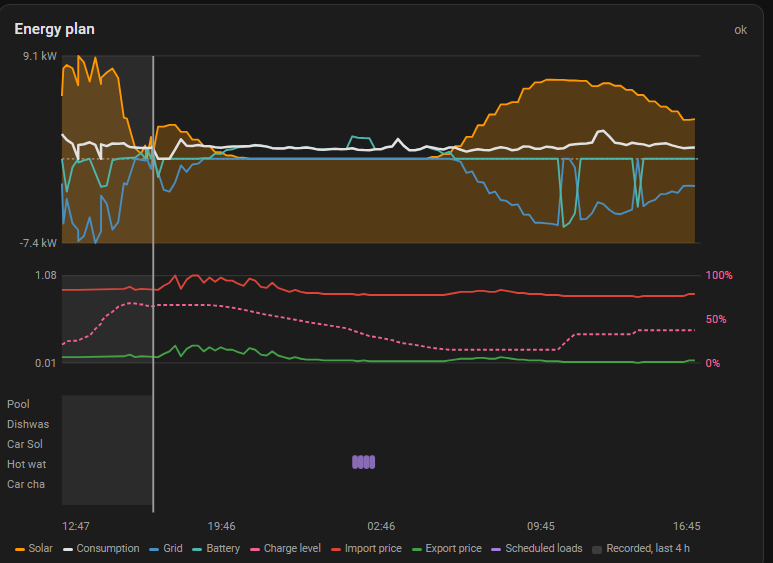
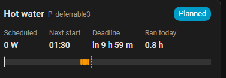

# Dashboard cards

Two cards ship with the integration and register themselves — no separate
Marketplace install, and no way for the cards and the integration to drift to
different versions.

**`custom:emhass-plan-card`** — the whole plan in one view: solar as a filled
area, consumption and grid as lines, battery charge level and both prices
below, and a row per deferrable load showing when it is scheduled to run. A
vertical marker shows *now*.



```yaml
type: custom:emhass-plan-card
```

**`custom:emhass-deferrable-card`** — one deferrable load: whether it should
run now, its scheduled power, next start, runtime today, a timeline of its
schedule, and the day-to-day controls — **Run now**, and on an on-demand or
surplus load **Requested** with its deadline or energy cap.

**Enabled** is deliberately not on the card. Turning it off takes the load out
of the optimisation entirely, which is a setup decision rather than a daily
one, and a switch that far-reaching does not belong under a thumb on a card
that gets tapped every day. The header still reads "Disabled" while it is off,
and the switch is on the load's own device page.

On a [sequence load](deferrable_loads.md#sequence-loads) the card shows a
running cycle as "Running · step 3 of 6", even through a 0 W step. *Ran
today* becomes the cycle step, then "Done" once the day's cycle has finished.
*Nominal power* shows the sequence's peak, and the run list shows one run per
cycle.



```yaml
type: custom:emhass-deferrable-card
load: Dishwasher    # omit to show the first load
```

Both find their entities through the entity registry rather than by guessing
entity ids, so renaming an entity does not empty the card. Neither takes any
configuration beyond the above.

## Alternative plan and overview cards

Two more cards draw the same sensors a different way. They sit beside the plan
and overview cards rather than replacing them, and both have a visual editor
where every part can be switched off.

**`custom:emhass-horizon-card`** — the plan as stacked panels on one time axis:
where the power comes from (solar, battery, grid) above zero and where it goes
(charging, export) below it with the house consumption as a line; the buy
price as a stepped line with the cheapest and dearest named; the charge level;
and a rail per deferrable load with the time each run ends and, where the load
has one, its deadline. Move the pointer over it and the readout row shows
every value at that moment; the past side is shaded.

```yaml
type: custom:emhass-horizon-card
history_hours: 3
horizon_hours: 24      # 0 or omitted = the whole plan
show_totals: false
```

| Option | Default | Does |
| --- | --- | --- |
| `title` | `Energy plan` | the card heading |
| `show_readout`, `show_power`, `show_price`, `show_soc`, `show_loads`, `show_totals` | `true` | switch a whole part off |
| `show_solar`, `show_battery`, `show_grid`, `show_house`, `show_sell`, `show_extremes` | `true` | switch one series, or the price labels, off |
| `history_hours` | `4` | how far back the window reaches; `0` starts at now |
| `horizon_hours` | `0` | how far ahead it reaches; `0` is the whole plan |
| `solar_entity`, `house_entity`, `grid_entity`, `battery_entity` | the Companion's sensors | measured power for the shaded past |
| `invert_battery` | `false` | for a `battery_entity` that is positive while charging |
| `power_scale` | `auto` | `linear`, `compressed` (a square-root axis that gives short peaks less height and the ordinary hours more), or `auto`, which compresses only when a peak dwarfs the rest. The caption says when the axis is compressed |
| `price_scale` | `fit` | `fit` starts the axis near the lowest buy price so small differences show; an export price far below it is then left to the readout. `both` fits buy and export together, `zero` starts at zero |

The price colour can be changed from a theme with `--emh-studio-price`, like
`--emh-studio-solar`, `--emh-studio-battery` and `--emh-studio-grid`.

**`custom:emhass-briefing-card`** — the plan to be read rather than studied: a
headline saying what the house is doing and until when, four live figures,
price / solar / battery / loads as thin lanes on one axis, an agenda of what
happens next (load starts, battery turns, the cheapest and dearest price, the
spare-solar window), and the money.

```yaml
type: custom:emhass-briefing-card
figure_4: price
agenda_items: 4
show_footer: false
```

| Option | Default | Does |
| --- | --- | --- |
| `title` | `Energy briefing` | the small heading |
| `show_headline`, `show_gauge`, `show_figures`, `show_price`, `show_solar`, `show_battery`, `show_loads`, `show_agenda`, `show_footer` | `true` | switch a part off |
| `figure_1` … `figure_4` | `solar`, `house`, `battery`, `grid` | what each figure shows: also `soc`, `price`, `sell_price`, `solar_ahead`, `surplus`, `balance`, `savings`, `cost_today`, `saved_today`, `loads`, or `none` |
| `history_hours` | `2` | how far back the lanes reach |
| `horizon_hours` | `0` | how far ahead the lanes and the agenda reach; `0` is the whole plan |
| `agenda_items` | `6` | the most lines the agenda shows |
| `solar_entity`, `battery_entity`, `invert_battery` | the Companion's sensors | measured power for the live figures and the solar lane's past |

They are drawn as inline SVG with no charting library and no build step, and
they use Home Assistant's energy-dashboard CSS variables, so they follow your
theme in both light and dark mode.

> If you manage Lovelace resources in YAML rather than through the UI, the
> integration cannot register the module for you. It logs the exact snippet to
> add at startup; look for it in the log after a restart.
