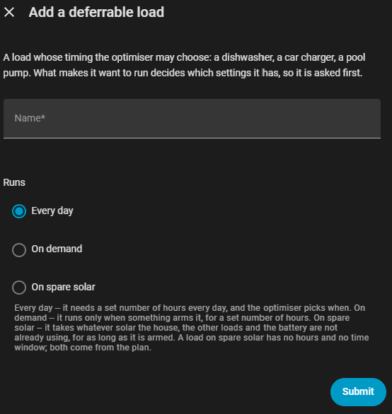

# Deferrable loads

Settings-triggered optimisation waits for three seconds without further
changes. Each change restarts the timer, shared across all loads, so an
automation can update several settings before one solve uses the final values.
Settings save and entities update immediately. Automations with pauses longer
than three seconds can still trigger intermediate solves.

Parameter changes request optimisation only while the load's **Enabled**
switch is on. To batch changes in an automation, disable the load, update its
settings, then enable it. Both enable/disable transitions queue a plan refresh;
intermediate edits while disabled still save and update their entities.
This applies to standard and thermal loads, including hot-water plans.
Scheduled optimisations and explicit run actions continue normally.

A deferrable load is anything whose *timing* the optimiser may choose: a
dishwasher, a car charger, a pool pump. Tell it the load needs three hours
before morning and it decides which three.

Add them under **Settings → Devices & Services → EMHASS Companion → Add
deferrable load**. Each becomes its own device, with its own entities, added
and removed independently.



**Runs** is asked before anything else, because it decides which other
settings the load even has — see [on-demand loads](on_demand_loads.md) and
[surplus loads](surplus_loads.md) for the other two.

Setup asks only for things that rarely change — power, hours, whether it runs
at full power or can be modulated, whether it may be interrupted. Everything
you might change day to day becomes a control on the load's own page:

| Entity | |
|---|---|
| `binary_sensor.<load>_should_run` | **The one to automate against.** Unknown rather than off when there is no usable plan |
| `binary_sensor.<load>_running` | What the load is actually observed doing right now, from its power sensor or control entity. Off (not unknown) when there is nothing to observe |
| `sensor.<load>_scheduled_power` | Planned power now, with the full schedule in its `schedule` attribute |
| `sensor.<load>_next_start` | When it is next due to start |
| `sensor.<load>_runtime_today` | How long it has run today |
| `switch.<load>_enabled` | Include this load in the optimisation at all |
| `switch.<load>_restrict_to_a_time_window` | Whether the window below applies |
| `time.<load>_earliest_start` / `_latest_finish` | The window. May cross midnight |
| `text.<load>_power_when_running` | Power in W: one value, or a comma-separated [sequence](#sequence-loads) |
| `number.<load>_hours_needed_per_day` | |
| `number.<load>_minimum_on_time` / `_minimum_off_time` | Protects compressor-driven loads from short-cycling — see below |
| `switch.<load>_battery_lockout` | Price the battery out of discharging into this load's window — see [battery_lockout.md](battery_lockout.md) |
| `button.<load>_run_now` | Run this load immediately, regardless of recurrence. Unavailable on a surplus load — see [surplus_loads.md](surplus_loads.md) |

Two distinctions worth knowing, because conflating either causes confusion:

**Run now overrides the signal, not the plan.** Pressing it makes
`should_run` on immediately, but EMHASS still solves the rest of the plan
around its own schedule for the load, which is why it only asks for *more*
than the plan already accounts for — it clears itself once the load's
configured hours for the day are met, and there is deliberately no equivalent
"force off": that would leave the rest of the plan solved as if the load were
still running. To leave a load out of planning entirely, turn off its
**Enabled** switch instead. Keeping these separate means pausing a load never
silently changes the problem being solved.

It is unavailable on a **surplus** load, where "regardless of the plan" would
mean charging off the grid at midnight, and where the hours it clears itself
against are structurally zero — so it could not disarm itself either. *Start
as early as possible* is the equivalent there: it keeps the surplus gate and
only gives up the optimiser's freedom to place the run later in the day.

**A power sensor is optional but worth adding.** With one, the integration
can tell EMHASS the load is already running — so it is not charged a
start-up cost twice, and is not asked to repeat work it has already done
today. Runtime is counted from that sensor and reset at local midnight,
because EMHASS has no notion of a day boundary for it.

Automating against a load looks like:

```yaml
triggers:
  - trigger: state
    entity_id: binary_sensor.dishwasher_should_run
    to: "on"
actions:
  - action: switch.turn_on
    target:
      entity_id: switch.dishwasher
```

## Recurrence: daily vs on-demand

By default a load wants its configured hours every single day. Some loads
don't work like that — a hot water tank only needs heating once its
temperature has dropped, a dishwasher only after someone has loaded it.
Switch `select.<load>_recurrence` to *On demand* and the load wants nothing
until something arms it via `switch.<load>_requested` — typically an
automation reacting to a sensor or a button press. The load then enters the
plan until its hours are met, at which point the switch turns itself off.
An unfulfilled request survives past midnight, so a dishwasher loaded late
at night still runs in the cheap early-morning hours.

See [on_demand_loads.md](on_demand_loads.md) for the full mechanics, including
optional deadlines ("run within N hours").

`select.<load>_recurrence` actually has a third position, *On spare solar* —
see [surplus_loads.md](surplus_loads.md) for what that changes.

## Sequence loads

Some appliances don't draw one steady power. A washing machine heats, then
washes, then spins, and a flat 2 kW in the plan would put its heating step
wherever it fits rather than where it is cheap. Enter **Power when running**
as a list instead, one value in W per optimisation step:

```text
150, 2000, 2000, 300, 0, 600
```

- The values run in order, one per step. The last value repeats until
  *Hours needed* is filled, so `500, 2000` with 1 h at 15-minute steps is
  `500, 2000, 2000, 2000`.
- The first value must be at least 10 W. That is the Companion's sign that
  the cycle has started. A later step may be 0 W, for a soak or a pause.
- *Hours needed* must cover at least one step per value. A list longer
  than the runtime is refused in the form.
- Needs EMHASS 0.18.8 or newer. On an older EMHASS the load is left out of
  the plan with a warning, and **Run now** is unavailable.
- *Every day* and *On demand* loads only. Spare-solar and thermal loads
  take a single value.

**A cycle is one run.** When the plan's start arrives, or you press
**Run now**, the Companion starts a cycle and holds the load on until the
cycle's last step, through 0 W and low stages. Each new plan gets the steps
that remain, from where the cycle has got to. Progress is saved, so a restart
of Home Assistant mid-cycle carries on rather than starting over. A planned
start and **Run now** share the same cycle: pressing **Run now** during a
cycle does nothing, and a planned start after **Run now** doesn't start a
second one.

- **Requests during a cycle.** An *On demand* load requested while a cycle
  is already running counts that cycle as the run for the request.
- **Finishing.** A cycle ends when its time is up, not when the load goes
  quiet. A low or 0 W step looks idle, so the early finish on idle that
  ordinary loads have is off here. A finished *Every day* cycle counts for
  that day.
- **Stopping.** Turn **Enabled** off, turn **Requested** off, or change
  **Recurrence**. The next cycle starts again from the first step.
- **Changing the sequence.** Edit the Power text entity
  (`text.<load>_power_when_running`) or use **Reconfigure** on the load. A
  change applies to the next cycle, not the one already running. Typing one
  value turns the load back into a constant one.
- **Ignored settings.** A sequence sets the power of every step, so
  *Lowest power while running*, *Runs at full power only*, *Must run in one
  unbroken block*, *Most starts per plan* and the minimum on/off times are
  unavailable on a sequence load.

**Entities.** `binary_sensor.<load>_should_run` stays on for the whole
cycle and has the attributes `power_sequence`, `sequence_step` (1-based) and
`sequence_steps` while a cycle runs, plus `last_completed_day` and
`sequence_done`. A cycle in an overnight window counts for the day the
window opened.
`binary_sensor.<load>_running` stays measured, so it reads off during a 0 W
step. `sensor.<load>_scheduled_power` has `power_sequence` and `cycles`, the
planned cycle blocks as `[{start, end}]`, so a 0 W step doesn't split one
cycle into two runs.

## Thermal loads

A thermal load is a variant whose *temperature* the optimiser controls rather
than its run time: a heat pump, direct electric heating, an air conditioner.
See [thermal_loads.md](thermal_loads.md) for the full detail and calibration
advice.

## Surplus loads

A load that only ever wants energy which would otherwise leave the house —
the motivating case is a pool heater. Armed with the same **Requested** switch
as an on-demand load, plus `switch.<load>_start_asap` (*Start as early as
possible*) to take the front of the sun rather than wherever in the day suits
it best — paid for by claiming a few per cent less of the day's surplus, which
is what leaves room in the window to move the run into. See
[surplus_loads.md](surplus_loads.md).

The mode is a Companion construct: EMHASS has no surplus mode, and a surplus
load reaches it as an ordinary deferrable with an hours target and a window
computed here.

## Minimum on/off time

`number.<load>_minimum_on_time` / `_minimum_off_time` give a compressor-driven
load (a heat pump, a freezer) a minimum dwell time once it switches on or off,
so the plan cannot ask it to cycle faster than the hardware allows. Both
default to zero (no minimum). They only apply to a daily or on-demand load —
a load on spare solar has no hard timing constraints, for the same reason it
has no maximum-startups setting: a broken-cloud day can make a hard timing
requirement infeasible against a run window the plan itself derives.

Sent to EMHASS as `def_minimum_on_time` / `def_minimum_off_time`, in the same
per-timestep units as the rest of the `def_*` settings. Each run also reports
back how long the load has already been continuously on or off, as
`def_current_on_timesteps` / `def_current_off_timesteps`, so a dwell time in
progress is still honoured correctly across restarts rather than resetting to
zero on every solve.

## Load groups

Two or more loads can share a circuit — a subpanel or fuse limit, or an EV
charger and an immersion heater that must never run together. See
[load_groups.md](load_groups.md).

## Battery lockout

`switch.<load>_battery_lockout` prices the battery out of discharging into
this one load's window, without changing how it serves everything else. Off
by default. See [battery_lockout.md](battery_lockout.md).
