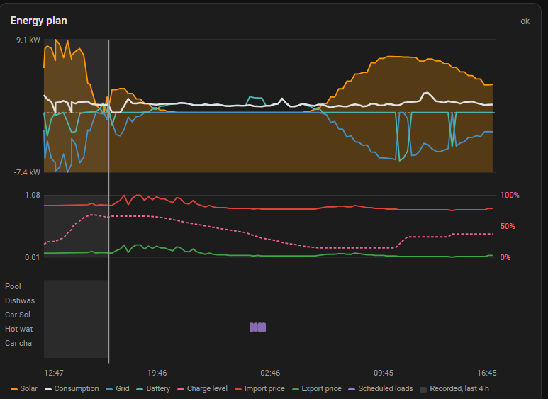
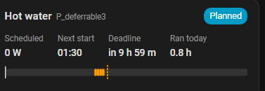

# Dashboard cards

Two cards ship with the integration and add themselves to Home Assistant —
no separate install, and nothing that can end up on a different version
than the integration itself. A third, the tank temperature card, is described
below.

## Plan card

```yaml
type: custom:emhass-plan-card
```

The whole plan in one view: solar as a filled area, consumption and grid as
lines, battery charge level and both prices below it, and a row per
deferrable load showing when it's scheduled to run. A vertical line marks
*now*.



## Deferrable load card

```yaml
type: custom:emhass-deferrable-card
load: Dishwasher    # omit to show the first load
```

One load at a time: whether it should run now, its scheduled power, next
start, runtime today, a timeline of its schedule, and its enable/mode
controls.



## Tank temperature card

```yaml
type: custom:emhass-tank-card
load: Hot water tank    # omit to show the first thermal load
history_hours: 4        # how much recorded measurement to draw before now
```

The temperature plan of one thermal load, such as a hot-water tank: the
planned temperature as a stepped line between the minimum and maximum it was
told to stay inside. A tank heated in a burst while power is cheap and then
coasting down towards its floor is the plan working. A tank that has a
temperature sensor also gets its recorded reading drawn before *now*.

## Adding a card

In a dashboard, **Add card → search for "EMHASS"**, or paste the YAML above
into an existing view in YAML mode. The cards find their entities
automatically, so renaming an entity later won't break them.

> If you manage your dashboards entirely in YAML rather than through the
> UI, the integration can't register itself for you — check the log after a
> restart for the exact resource line to add.
