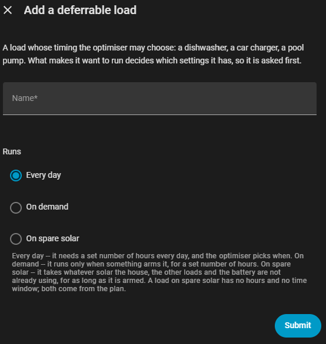
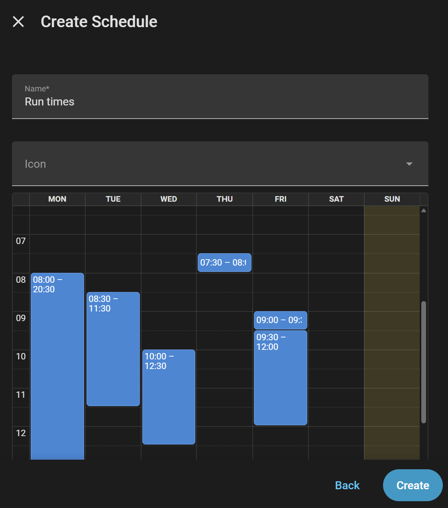
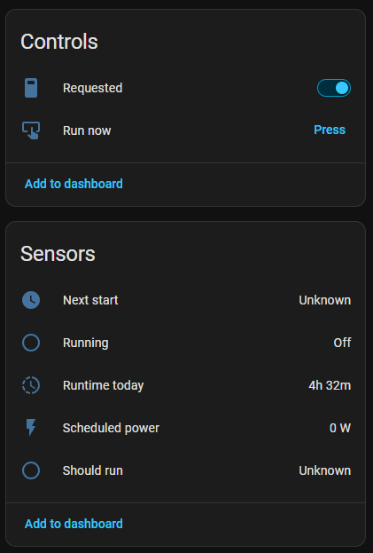

# Deferrable loads

Settings-triggered optimisation waits for three seconds without further
changes. Each change restarts the timer, shared across all loads, so an
automation can update several settings before one solve uses the final values.
Settings save and entities update immediately. Automations with pauses longer
than three seconds can still trigger intermediate solves.

To update several parameters from an automation, turn the load's **Enabled**
switch off, change its settings, then turn it on again. Disabling updates the
plan to exclude the load; edits while disabled save without requesting
optimisation; enabling requests a new plan using the final settings. This works
for every deferrable load, including room heating and hot-water tanks.
Scheduled optimisations and explicit run actions continue normally.

A deferrable load is anything whose **timing** can move — a dishwasher, a
car charger, a pool pump. Add one from **Settings → Devices & Services →
EMHASS Companion → Add deferrable load**.

## Add a deferrable load



- **Name**
- **Runs** — decides which questions come next, and which settings the load
  ends up with:
    - **Every day** — it needs a set number of hours every day, and the
      optimiser picks when.
    - **On demand** — it only runs when something arms it, for a set number
      of hours. See the *Recurrence* and *Requested* entries below.
    - **On spare solar** — it takes whatever solar the house, the other
      loads and the battery aren't already using, for as long as it's
      armed. Has no hours and no time window of its own — both come from
      the plan. This mode is a Companion feature; EMHASS has none of its
      own, so there's nothing to set up for it on the EMHASS side. See
      **[Surplus loads](surplus_loads.md)** for the extra sensors this adds.

## Load settings

The next screen sets the load's starting values. Which fields it shows depends
on the **Runs** answer above. Power, hours and timing settings can be changed
on the load's device page afterwards. Use **Edit deferrable load** to change
the connected sensors, controls or schedule.

- **Power when running** — roughly what it draws while on, in W. For an
  appliance whose draw changes through its program, such as a washing
  machine, enter one value per optimisation step separated by commas, for
  example `150, 2000, 2000, 300`. The last value repeats until *Hours needed*
  is filled. See [Sequence loads](../deferrable_loads.md#sequence-loads).
- **Advanced settings** — the collapsed section holds everything below
  except *Power when running*, *Hours needed per day*, *Earliest start* /
  *Latest finish* and the sensor, control and schedule pickers. The defaults
  suit most loads.
- **Lowest power while running** — the least it may draw, if it can
  modulate. Only used when *Runs at full power only* is off.
- **Runs at full power only** — on for a dishwasher or pump, which are
  either on or off. Off for something whose power can be varied, such as a
  car charger.
- **Cost of starting** — discourages switching on and off repeatedly. Leave
  at zero unless that's a problem. On spare solar this is the right way to
  stop short-cycling: it prices a restart rather than forbidding a break, so
  the load still runs in one block on a clear day but may split across two
  peaks on a cloudy one.
- **Hours needed per day** — how long it needs to run in total; the optimiser
  chooses when. Rounded to a whole number of plan timesteps.
- **Earliest start** / **Latest finish** — the time window. Only used if you
  turn the load's *Restrict to a time window* switch on afterwards. The
  finish may be earlier than the start, for an overnight window.
- **Must run in one unbroken block** — on if interrupting it would be a
  problem, such as a wash cycle.
- **Most starts per plan** — a cap on how many times it may switch on.
- **Minimum time on** / **Minimum time off** — once switched on or off, it
  must stay that way at least this long. Protects compressor-driven loads
  from short-cycling. Zero means no minimum.
- **Energy needed** — an optional total, in kWh: the load stops asking once
  it's had this much. Zero lets it run on whatever solar is spare until you
  turn its *Requested* switch off.
- **Spare solar headroom** — how much spare solar there must be *beyond* this
  load's own draw before a timestep counts. A margin against the forecast
  coming in light.
- **Surplus priority** — only matters with more than one load on spare solar.
  The lowest number claims the shared surplus first; ties break by name.
- **Running sensor** — optional, and the most reliable way to tell the
  optimiser whether the load actually ran — catching a run that finished
  early, never happened, or started at a different time. A power sensor gives
  the most detail (any unit is converted to watts); a plain on/off
  `binary_sensor` works too.
- **Control entity** — optional. If set, the integration switches this on and
  off to follow the plan once you enable control, and its state doubles as
  the running signal when there's no power sensor. Leave it empty to keep
  control in your own automations.
- **Allowed times schedule** — optional. Choose a weekly Schedule helper to
  allow different times on different days. See [Weekly allowed times](#weekly-allowed-times).
- **Power control (optional)** — the charger's writable power setting in W
  or kW, if it supports one. See [Optional reduced charging power](#optional-reduced-charging-power).

With neither a running sensor nor a control entity, the optimiser falls back
to trusting its own previous plan — assuming the load ran whenever it was
scheduled to, which is only as accurate as your own follow-through.

## Configuration

Every field the load's device page can show, in the order it appears:

- **01. Enabled** — include this load in the plan at all. Off parks it —
  the optimiser skips over it entirely.
- **02. Hours needed per day** — how many hours it should run each day.
  *Every day* loads only.
- **03. Power when running** — how much it draws at full power, in W. A
  text box: one value, or several separated by commas (one per step) for a
  load whose power changes through its program.
- **04. Lowest power while running** — the least it may draw while on, if
  it can modulate. Only used when *12. Runs at full power only* is off.
- **05. Earliest start** — the window may not start before this time.
- **06. Latest finish** — the window may not run past this time. Together
  with 05, only applies when *13. Restrict to a time window* is on.
- **07. Run within** — a deadline, in hours from when it's armed. *On
  demand* loads only.
- **08. Most starts per plan** — a cap on how many times it may switch on.
  0 means no cap.
- **09. Cost of starting** — a small penalty added each time it switches on,
  to discourage it from starting and stopping repeatedly.
- **10. Recurrence** — *Every day* / *On demand* / *On spare solar*. Same
  choice as *Runs* above — change it here any time.
- **11. Must run in one unbroken block** — forces a single continuous run
  instead of splitting across several.
- **12. Runs at full power only** — on: strictly on/off at full power. Off:
  it can modulate down to *04. Lowest power while running*.
- **13. Restrict to a time window** — turns *05* and *06* on or off.
- **14. Energy needed** — an optional total energy cap, in kWh. 0 means no
  cap. *On demand* and *On spare solar* loads only.
- **15. Spare solar headroom** — extra margin, in W, a moment must clear
  above the load's own draw before it counts as "spare". *On spare solar*
  loads only.
- **16. Surplus priority** — which load gets first claim on spare solar when
  you have more than one. Lower number goes first. *On spare solar* loads
  only.
- **17. Minimum time on** / **18. Minimum time off** — once the load switches
  on or off, it must stay that way at least this long, so the plan can't ask
  it to cycle faster than the hardware allows. Protects compressor-driven
  loads (a heat pump, a freezer) from short-cycling. 0 means no minimum.
  *Every day* and *on demand* loads only — a load on spare solar has no hard
  timing constraints of its own.

## Editing a load

Use **Edit deferrable load** in the integration's menu to change **Name**,
**Power when running**, **Running sensor**, **Control entity**,
**Allowed times schedule** or **Power control (optional)**. Runtime, the
simple time window and the load model are controls on the load's own device
page, changeable there or from an automation.

## Weekly allowed times

A weekly schedule tells Companion **when a load is allowed to run**. For
example, allow the dishwasher during the day on weekdays and later on
weekends. The optimiser still chooses the best time inside those blocks;
opening a block does not start the appliance by itself.

This is optional and requires **EMHASS 0.18.9 or newer**. Leave **Allowed
times schedule** empty if the existing earliest-start/latest-finish window
is enough. Weekly schedules apply to standard deferrable loads, rather than
room-heating or hot-water tank models.

### 1. Create a Schedule helper

1. In Home Assistant, go to **Settings → Devices & services → Helpers**.
2. Select **Create helper**, search for `Schedule`, then select **Schedule**.

{ width="600" }

### 2. Draw the allowed times

1. Give it a clear name, such as **Dishwasher allowed times** or **Car charging times**.
2. Press and drag in each day's column to add allowed blocks. Click a block
   to enter exact start and end times.
3. Add more blocks if needed, then select **Create** to save the helper.

{ width="600" }

The blue blocks are **allowed time**. Blank areas are **waiting time**. A day
with no blocks does not allow a run. The pattern repeats every week, using
Home Assistant's local time.

For an overnight period, split it at midnight: Monday **22:00–24:00**, then
Tuesday **00:00–06:00**. Blocks may touch but cannot overlap. If your plan
uses 15-minute steps, choose times such as 08:00, 08:15 or 08:30: a whole
planning step must fit within the allowed time.

### 3. Connect it to the load

1. Open **Settings → Devices & services → EMHASS Companion**.
2. Add a deferrable load, or choose **Edit deferrable load** for an existing one.
3. Set **Allowed times schedule** to the helper you created, then save.

Keep the load's **Enabled** switch on. For an **On demand** load, also turn
on **Requested** when the appliance is ready. These controls answer different
questions:

| Setting | What it means |
|---|---|
| **Enabled** | Include this appliance in planning. |
| **Requested** | It needs a run, for example because the dishwasher is loaded. |
| **Allowed times schedule** | These are the times when that run may happen. |

If **Restrict to a time window** is also on, the load must fit **both** that
window and the weekly blocks. Turn that switch off if you want the weekly
schedule to be the only time restriction. Several loads can share one helper;
editing it changes the allowed times for all of them.

To change the weekly pattern later, open the helper under **Settings →
Devices & services → Helpers**. Companion reads the updated schedule for
the next plan and applies the current block's restrictions immediately.

### Optional reduced charging power

Skip this part for ordinary on/off appliances. Time blocks work without
any additional data or power control.

For an adjustable charger, each block can also specify its maximum power:

1. Open the Schedule helper and click the block you want to limit.
2. In the block's **Additional data**, enter:

    ```yaml
    power_limit_w: 3000
    ```

3. Save the block and the helper. The value is always in **watts**: `3000`
   means **3 kW**, even if the charger's own setting uses kW.

Leave **Additional data** empty in blocks where normal power is allowed.
You do not need to edit `configuration.yaml`.

For example, create two touching blocks for a charger with a normal power
of 7,000 W:

| Allowed block | Additional data | Result |
|---|---|---|
| 16:00–20:00 | `power_limit_w: 3000` | Charging may use up to 3 kW. |
| 20:00–24:00 | Leave empty | Charging may use up to its normal 7 kW. |
| No block | — | Charging waits. |

A limit is a **maximum**, so the optimiser may choose less power or wait.
Lower power needs more charging time for the same energy.

To let Companion apply the changing power to your charger:

1. Edit the load and select its start/stop **Control entity** and its writable
   **Power control (optional)** number entity. That number must use **W** or
   **kW**; a charging-current setting in amps cannot be selected for this purpose.
2. Select a real **Running sensor** that measures charging power so progress
   can be measured when power changes.
3. On the load's device page, turn **Runs at full power only** off. Set
   **Power when running** to its normal maximum and **Lowest power while
   running** to the charger's minimum charging power.
4. Enable control in Companion when you want it to operate the charger.

Companion sets the power before starting charging. It respects the charger's
minimum, maximum and available increments, rounding down when necessary.
A limit below the minimum stops charging. Setting `power_limit_w: 0`
blocks the load during that block.

**A fixed-power appliance cannot slow down.** If a block's limit is below
its normal power, it waits. Sequence appliances and adjustable loads without
a writable power control also wait during a reduced-power block.

### If the load is waiting

- Check **Enabled**, and **Requested** for on-demand loads, then check that
  today's helper has a block at the expected time.
- Check that the run can fit. A two-hour unbroken cycle needs a continuous
  two-hour allowed period; reduced charging power needs extra time. If the
  remaining run cannot fit, Companion leaves it out of that plan, shows a
  warning and keeps the request pending.
- Check **Should run** for the current decision and its reason. Its
  `power_limit_w` attribute shows the current permitted power. **Scheduled
  power** shows the last plan, which may predate a changed restriction.
- A missing or unavailable helper or power control blocks a new start.
  The rest of the plan, including the battery, is still made.
  Invalid power limits also block it; use a number of watts with no unit suffix.

**Run now** can start outside the weekly blocks, but still respects the
power limit inside an active block. It cannot bypass an unavailable helper.
A sequence cycle already in progress is allowed to finish when a block closes.

For implementation details and planning behaviour, see the
[technical reference](../deferrable_loads.md#weekly-allowed-times-and-power-limits).
For more about editing the helper, see the
[Home Assistant Schedule documentation](https://www.home-assistant.io/integrations/schedule/).

## Load groups

Two or more of your loads can share a circuit — a subpanel or fuse limit, or
an EV charger and an immersion heater that must never run at once. That's a
**load group**, added the same way as a load, from **Add load group** in the
integration's menu:

- **Name**
- **Loads in this group** — at least two existing deferrable loads.
- **Only one may run at a time** — on if these loads must never overlap, such
  as two appliances on the same fuse.
- **Shared power budget** — the combined power they may draw at once, in W.
  Required unless *Only one may run at a time* is on.

See **[Load groups](../load_groups.md)** in the technical reference for the
full detail.

## Longer forecast windows

When the plan looks more than 24 hours ahead, a load that runs **every day**
inside a **time window** is planned once per day, not once in total. Set it
up as usual: *Hours needed per day*, plus *Earliest start* and *Latest
finish*. A 48-hour plan then schedules the window today and the one
tomorrow, each with the full hours.

- **Partly covered windows wait.** A window that only half fits in the
  forecast is not planned yet. Asking for a full day's hours inside half a
  window would only force a bad schedule. It appears once the plan reaches
  far enough.
- **Today's run counts for today only.** Once today's run is done, tomorrow's
  window still gets its full hours.
- **Water tanks stay one load.** A tank has a single temperature, so it is
  not duplicated. Its heating window is stretched from the first window to
  the last one in the plan, and *Most starts per plan* is multiplied by the
  number of windows. Heating between the windows is therefore allowed; the
  temperature targets still decide when it has to happen.
- **Not for every load.** Loads on spare solar, room thermal loads, on-demand
  loads and daily loads without a time window are planned as before. Windows
  that sit closer together than the load's *Minimum time off* are also
  planned as one.
- **Manual overrides cover the next run only.** *Run now* and a forced-on
  state apply to the window that is open or next, not to later days.
- **Limit:** an overnight run that began before midnight loses the hours it
  already ran when the daily counter resets, so it can be asked for again
  after midnight.

The extra `P_deferrable` columns you may see in EMHASS's own output (a load
named *Car (day 2)*, for example) are internal. The integration adds them
back into the load before anything else reads the plan, so the sensors,
the *Should run* switch and the executor only ever see one schedule per load.
They are listed as `deferrable_extra_rows` in the diagnostics download.

## Controls & Sensors



- **Requested** (switch) — arm a run. *On demand* and *On spare solar*
  loads only. Turning it off cancels a pending run.
- **Start as early as possible** (switch) — take the spare solar as soon as
  there is any, instead of letting the optimiser pick a moment later in the
  day. *On spare solar* loads only. It pays for that by claiming a few per cent
  less of the day's surplus. Off by default, and off is usually the better
  setting — see **[Surplus loads](surplus_loads.md)**.
- **No battery for this load** (switch) — keep the battery from feeding this
  load specifically, without changing how it serves everything else. Off by
  default. See **[Battery lockout](../battery_lockout.md)**.
- **Run now** (button) — force the load on right now, regardless of the
  plan, while respecting active schedule power limits and helper availability.
  Not available on *On spare solar* loads, where ignoring the plan
  would mean running off the grid at night; use *Start as early as
  possible* there instead.
- **Next start** (sensor) — when it's next due to start.
- **Running** (binary sensor) — whether it's actually observed running.
- **Runtime today** (sensor) — how long it's run today.
- **Scheduled power** (sensor) — what the plan wants right now.
- **Should run** (binary sensor) — **the one to automate against.** Combines
  the plan with any manual override and current allowed-time/power restrictions.

## Diagnostic

- **EMHASS deferrable number** — which numbered slot (`P_deferrable0`,
  `P_deferrable1`, …) this load occupies in EMHASS's own output.
- **Spare solar budget** — how many hours the last plan allowed this load to
  ask for. *On spare solar* loads only — see
  **[Surplus loads](surplus_loads.md)**.

## Making it actually run something

Nothing above switches your appliance on by itself unless you set a
**Control entity** when adding the load. Without one, the load is advisory
only, and you automate against **Should run** yourself:

```yaml
triggers:
  - trigger: state
    entity_id: binary_sensor.dishwasher_should_run
    to: "on"
actions:
  - action: switch.turn_on
    target:
      entity_id: switch.dishwasher
```
