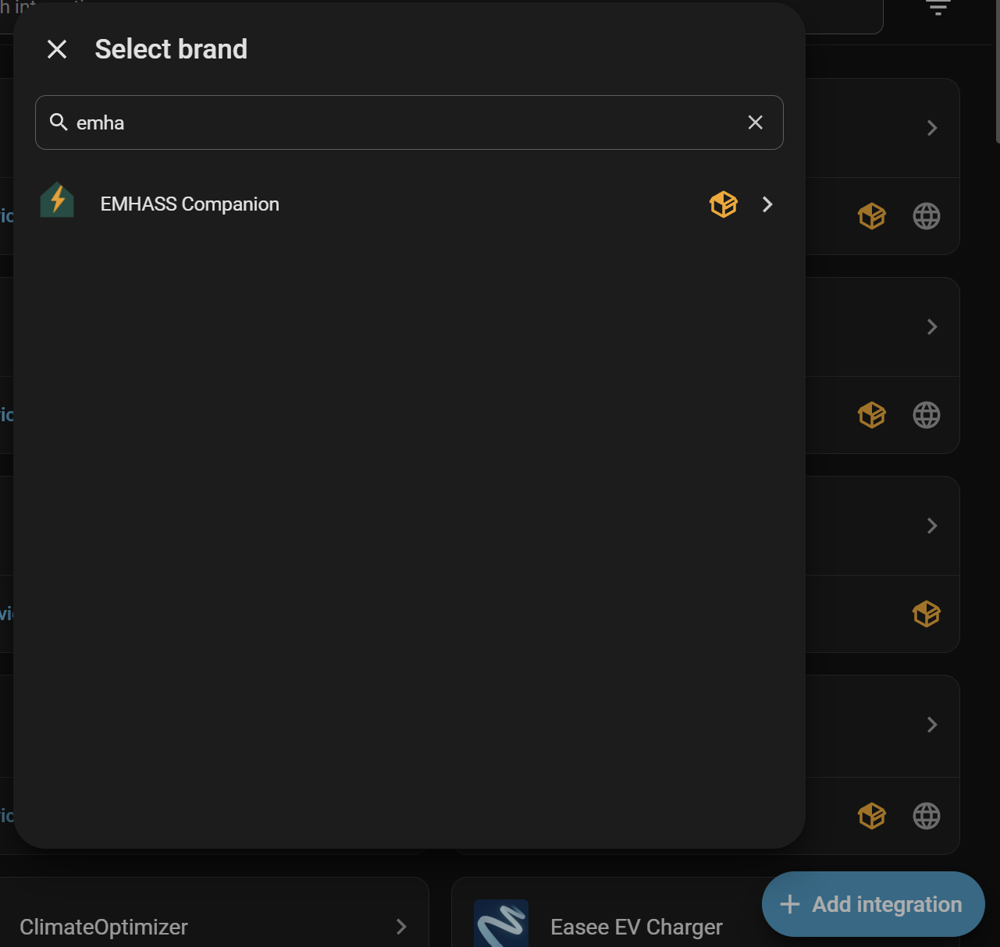

# Install

## What you need

- Home Assistant 2026.7 or newer.
- EMHASS itself, already installed and running — either the add-on or a
  container. EMHASS Companion talks to it; it doesn't include it.
- **EMHASS version 0.17.9 or newer.** A network tariff's demand charge needs
  0.18.0+ to price at all, 0.18.1+ for a windowed charge, and 0.18.2+ to price
  it on the tariff's own measurement interval rather than the optimizer
  timestep. The battery charge taper needs 0.18.3+, and the End SOC *Value of
  leftover energy* needs 0.18.5+. Tested up to EMHASS 0.18.6.
- The **Marketplace** (**Settings → Marketplace**) to install the integration.
  It is built into Home Assistant from 2026.11. On 2026.7 to 2026.10, install
  [HACS](https://hacs.xyz/) instead and use it the same way. Nothing to do if
  you already use HACS: the Marketplace takes over from it automatically when
  you update to 2026.11.

Nothing else is required. No battery, no solar panels and no dynamic
electricity tariff are all valid setups — you tell the integration what you
actually have during setup.

## Steps

1. **Install and start EMHASS**, if you haven't already — the add-on, or a
   container.
2. **Add this repository to the Marketplace**, then install **EMHASS Companion**.
   Either select the button below, or go to **Settings → Marketplace**, select
   **Add from link** in the upper-right corner, enter
   `https://github.com/smefa/emhass-ha-companion`, and select **Add**.

   

   The first time you open the Marketplace, you must select **I understand the
   risks and agree** before you can install. Installing needs administrator
   access, and adding a repository needs a GitHub connection (GitHub device
   sign-in).

   On Home Assistant 2026.10 or older, add this repository to HACS as a custom
   repository (category *Integration*) and install from HACS instead.

3. **Restart Home Assistant.**
4. Go to **Settings → Devices & Services → Add Integration**, and search for
   **EMHASS Companion**.

If you're running the EMHASS add-on, its address is filled in for you on the
first screen. Continue to **[Setup](setup.md)** for what each question after
that means.
