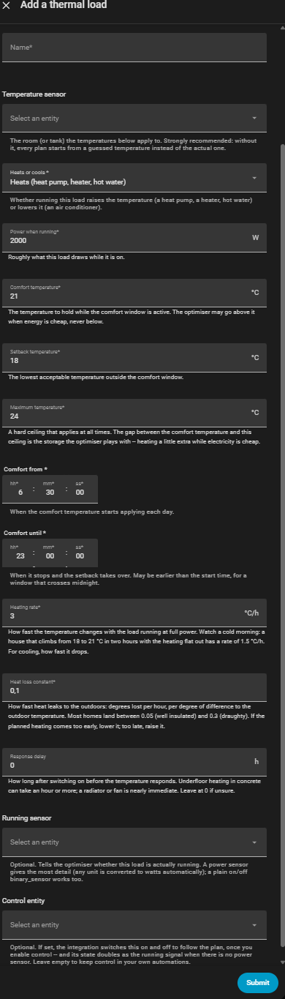
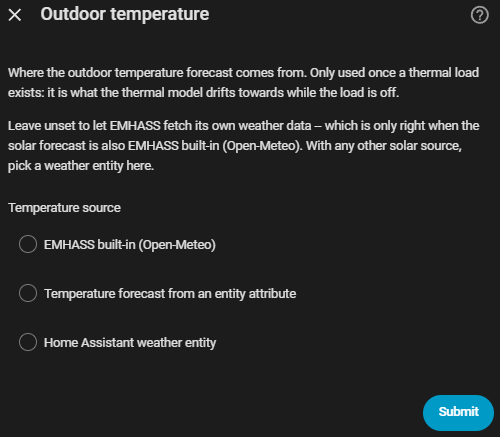

# Thermal loads

A thermal load is like a deferrable load, but its **temperature** is
controlled instead of its run time — a heat pump, direct electric heating,
an air conditioner. Add one from **Settings → Devices & Services → EMHASS
Companion → Add thermal load** — a separate button from *Add deferrable
load*.

## Add a thermal load



- **Name**
- **Temperature sensor** — the room (or tank) the settings below apply to.
  Strongly recommended: without it, every plan starts from a guessed
  temperature instead of the real one.
- **Heats or cools** — whether running the load raises the temperature (a
  heat pump, a heater) or lowers it (an air conditioner).
- **Power when running** — roughly what it draws while on, in W.
- **Comfort temperature** — the temperature to hold while the comfort
  window (below) is active. May go above this when electricity is cheap,
  never below.
- **Setback temperature** — the lowest acceptable temperature outside the
  comfort window.
- **Maximum temperature** — a hard ceiling, at all times.
- **Comfort from** / **Comfort until** — when the comfort temperature
  applies each day. May cross midnight.
- **Advanced settings** — the collapsed section holds the three model
  settings below (*Heating rate*, *Heat loss constant*, *Response delay*). The
  defaults are a reasonable starting point.
- **Heating rate** — degrees per hour at full power.
- **Heat loss constant** — degrees lost per hour, per degree of difference
  to the outdoor temperature.
- **Response delay** — how long after switching on before the temperature
  responds. An hour or more for underfloor heating in concrete, 0 for a
  radiator or fan.
- **Running sensor** — optional; tells the optimiser whether the load is
  actually running.
- **Control entity** — optional; if set, the integration switches this on
  and off to follow the plan, once you turn control on.

Temperature targets accept **5-95 °C** in both setup and the device controls.
This is the input range; the room-heating defaults are unchanged. Higher
targets do not switch models: a **Room** load retains its simple model with
heat loss relative to outdoor temperature. Choose **Water tank** explicitly
for water storage and estimated hot-water consumption.

## Its own device page

Every answer above becomes a setting on the load's device page, changeable
any time. A thermal load also keeps the same **Enabled**, time window
(**Earliest start** / **Latest finish** / **Restrict to a time window**),
**Most starts per plan** and **Cost of starting** settings as an ordinary
deferrable load — but has none of the run-time-target ones (*Hours needed per
day*, *Must run in one unbroken block*, *Recurrence*, *Requested*, *Run
now*), since its demand is the comfort band, not a number of hours.

It also gets one extra sensor:

- **Planned temperature** — the room temperature the plan currently expects,
  with the full forecast in its `forecast` attribute.

**Edit thermal load** in the integration's menu only asks for the things that
aren't controls: **Name**, **Temperature sensor**, **Heats or cools**,
**Running sensor** and **Control entity**. Everything else is on the load's
own page.

## Outdoor temperature



Once you have at least one thermal load, **Configure → Outdoor
temperature** appears, asking where the outdoor temperature forecast comes
from — it's what the room drifts towards while the load is off. A source is
required:

- **Home Assistant weather entity** — hourly forecast via
  `weather.get_forecasts`. Pick one that actually offers hourly data; daily or
  twice-daily forecasts are too coarse to schedule heating against.
  The other two sources are under the collapsed **Advanced settings** section
  (it opens by itself if one of them is already selected).
- **Temperature forecast from an entity attribute** — for a weather
  integration that exposes its forecast as a list-valued attribute instead of
  through an action, or a template sensor you build yourself.
- **EMHASS built-in (Open-Meteo)** — no weather integration or API key
  needed, but requires your home's location to be set correctly under Home
  Assistant's Settings → System → Home information, and is only correct when
  the solar forecast is also EMHASS built-in.

The follow-up screen asks for what that source needs. **Home Assistant
weather entity** wants just a **Weather entity**. **Temperature forecast from
an entity attribute** wants a **Forecast entity**, an **Attribute name**, a
**Timestamp field** and a **Temperature field** — values must be in degrees
Celsius, which is what EMHASS's thermal model assumes. **EMHASS built-in**
asks for nothing.

## Water tank with an immersion heater

Choose **Water tank** under **Add thermal load**. This first version is one tank
with one electric immersion element. Room is still the default, and existing
loads are never converted based on their temperature targets. Heat pumps,
multiple sources, stratification, automatic consumption learning and disinfection
schedules are not included.

Provide tank volume (litres), heater power (watts), a tank temperature sensor,
and explicit **Lowest standby temperature**, **Required hot-water temperature**
and **Maximum temperature** limits within your hardware's permitted range.

Choose **Number of hot-water periods** (1–8), then fill in one page per period:
optional name, **Hot water needed from / until**, and **Estimated consumption
for this period** in kWh of heat withdrawn, not heater electricity. For example,
create Morning and Evening periods with separate consumption estimates.

Water must be ready at each start, with the required tank temperature maintained
throughout the period. The lowest standby temperature applies between periods;
prices and PV still determine heating times. Zero consumption means no expected
withdrawal; availability targets and standby heat loss still apply. Consumption
from overlapping periods is added.

Each period has start/end time controls, a consumption number and an enable
switch on the tank device. Changes save immediately and request a fresh
optimisation without reloading the integration when the tank load is enabled.
While the tank load is disabled, edits save without requesting optimisation.
All settings-triggered solves share a three-second delay that restarts with
each change; values save immediately, including whole-plan action updates.
Disabled periods keep their
settings but contribute no withdrawal or required-temperature window. With all
periods disabled, only the lowest standby temperature applies.

Automations can use those entities or replace the whole plan atomically:

```yaml
action: emhass_companion.set_hot_water_plan
data:
  device_id: YOUR_TANK_DEVICE_ID
  periods:
    - name: Morning
      draw_start: "06:00:00"
      draw_end: "08:00:00"
      draw_energy_kwh: 3
      enabled: true
```

Supply 1–8 periods. Omitted `enabled` defaults to true. To suspend hot-water
availability, disable the periods; an empty plan is rejected. The action
validates every period before saving, then requests one optimisation. Adding
periods creates their controls live; controls for removed slots become
unavailable. Slot numbers and entity IDs stay stable when renamed or disabled.

Power, temperature limits and **Standby loss** remain restored device controls.
Edit volume, period count and schedules by reconfiguring the tank. Existing
periods are prefilled, and changes save only after the final page. Reducing the
count keeps the first periods. Legacy single-window tanks run unchanged until
edited: their old consumption becomes one period, whose times also set hot-water
availability when saved. New tanks have no separate comfort-time controls.
Standby loss is continuous heat loss in watts, not hot-water consumption. It is
under **Advanced settings** when the tank is first created and starts at 60 W.
The room-model tuning controls do not appear for tanks.

**Heater COP** (1 for an immersion element; a heat-pump water heater's seasonal
COP otherwise) and **Comfort penalty** (0 keeps the required temperature a hard
limit; above 0 it becomes a priced target) are also restored device controls.
Like standby loss, both are offered under **Advanced settings** when the tank is
first created.

Use the manufacturer's standing loss or calibrate during a no-draw period;
compare predicted temperature with the actual sensor before relying on the
schedule unattended. A single sensor cannot describe a stratified tank perfectly,
and unexpected draws can still exhaust the hot water. Estimated consumption is
not automatically learned from temperature changes.

The tank model needs a known EMHASS **0.18.8 or newer**, but no outdoor forecast
for immersion heating. Other forecast profiles keep their own requirements.
Windows follow local time and may cross midnight. Equal consumption endpoints
mean a full day. Daily energy is conserved through daylight-saving changes;
partial horizons receive only their overlapping share. Pre-heating ramps use actual
elapsed time.
ambiguous endpoints use the first occurrence and missing endpoints advance to
the next valid local time.

For enabled tanks, invalid/missing telemetry blocks new solves and switching, including
forced-on mode; Should run reports unknown. Existing switch state is left alone,
and control resumes only after a valid solve. Hardware thermostats and
over-temperature protection remain authoritative. Do not configure two loads
for the same physical heater or tank.

## Getting the numbers right

Start with the defaults and adjust from what you observe:

- Plan heats **too early** → heat loss constant too high, or heating rate
  too low.
- Comfort **missed** at the start of the window → heating rate too
  optimistic, or the response delay is real and set to 0.
- The plan never pre-heats → widen the gap between comfort and maximum
  temperature; that gap is what it has to play with.
