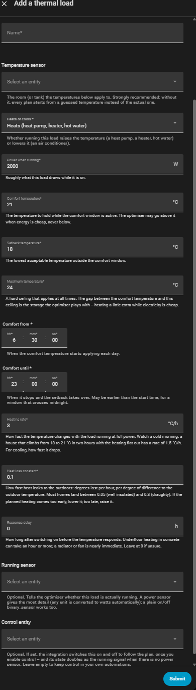
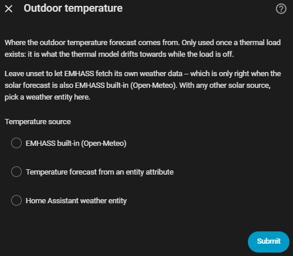

# Thermal loads

A thermal load is a deferrable load whose *temperature* the optimiser
controls rather than its run time: a heat pump, direct electric heating, an
air conditioner. Instead of "run three hours a day", the contract is "keep
this room between 18 and 24 °C, and at least 21 °C while we are awake" — and
EMHASS picks the cheapest hours that satisfy it, pre-heating into cheap
electricity where the band allows.

This maps onto [EMHASS's thermal model](https://emhass.readthedocs.io/en/latest/thermal_model.html)
(the recommended `min_temperatures` / `max_temperatures` form), with the
Companion translating human-scale settings into the per-timestep lists EMHASS
wants.

## Adding one

Settings → Devices & services → EMHASS Companion → **Add thermal load** — a
separate button from *Add deferrable load*, with its own questions:

| Question | Meaning |
| --- | --- |
| Temperature sensor | The room (or tank) the comfort band applies to. Read live on every optimisation as the plan's start temperature. |
| Heats or cools | Whether running the load raises the temperature (heat pump) or lowers it (air conditioning). |
| Power when running | Electrical draw at full power — this is the power EMHASS schedules. |
| Comfort / setback / maximum temperature | The band. Comfort holds inside the comfort window, setback outside it, and the maximum is a hard ceiling at all times. |
| Comfort from / until | The daily comfort window, which may cross midnight. |
| Heating rate | Degrees per hour at full power. In the collapsed *Advanced settings* section, along with the next two rows. |
| Heat loss rate | Degrees lost per hour, per degree of difference to outdoors (EMHASS's `cooling_constant`). |
| Response delay | Lag between switching on and the temperature responding (EMHASS's `thermal_inertia`) — an hour or more for underfloor heating in concrete, 0 for a radiator or fan. |
| Heat pump COP curve | Optional, under *Advanced settings*. Outdoor temperature and COP pairs, such as `7: 5.2, 0: 4.0, -10: 3.0`; the first pair is where the heating rate was measured. Each request scales the heating rate by the lowest COP over the forecast horizon divided by the first pair's COP, capped at 1. Heating only; needs a forecast the Companion reads itself (not EMHASS built-in). |
| Running sensor / control entity | Same as an ordinary deferrable load. |

Like an ordinary load, the answers only *seed* the load: from the moment it
exists, every optimiser-facing value (the comfort band, the window, the
physics) is an entity on the load's own device page, adjustable from a
dashboard or an automation without reloading anything.

Temperature targets accept **5-95 °C** in both setup and the device controls.
This is the input range; the room-heating defaults are unchanged. Higher
targets do not switch models: a **Room** load retains its simple model with
heat loss relative to outdoor temperature. Choose **Water tank** explicitly
for water storage and estimated hot-water consumption.

## Room, advanced heat pump

Under **Add thermal load**, choose **Room, advanced heat pump** to describe the
building and heat pump instead of a measured heating rate. The Companion sends
it as EMHASS's `thermal_battery` model, and EMHASS calculates the COP and the
heat demand per timestep from the outdoor forecast. It is a GUI over that model
only: it adds no physics of its own. Use it for heating; it is always sent with
`sense: heat`. See the [guide](guide/thermal_loads.md#room-advanced-heat-pump)
for step-by-step setup.

| Question | EMHASS key | Meaning |
| --- | --- | --- |
| Room temperature sensor | `start_temperature` | Required. Read on every request; when it is unavailable the key is omitted and EMHASS starts from 20 °C. |
| Electrical power when running | `nominal_power_of_deferrable_loads` | Electrical draw. EMHASS multiplies it by the COP. |
| Comfort / setback / maximum, comfort window | `min_temperatures` / `max_temperatures` | The same band as a **Room** load. |
| Thermal mass (m³) | `volume` | Concrete-equivalent mass; EMHASS's defaults `density` 2400 and `heat_capacity` 0.88 are sent with it. |
| Heated floor area (m²) | `area` | |
| Specific heating demand (kWh/m² per year) | `specific_heating_demand` | Heat, not electricity. |
| Supply temperature (°C) | `supply_temperature` | Default 35. |
| Carnot efficiency (*Advanced*) | `carnot_efficiency` | Default 0.4. COP = efficiency × (supply + 273.15) / (supply − outdoor), clipped by EMHASS to 1–8. |
| Base temperature (*Advanced*) | `base_temperature` | Default 18 °C. Degree-day demand is zero above it. |
| Annual heating degree days (*Advanced*) | `annual_reference_hdd` | Default 3000. |
| Thermal inertia (*Advanced*, h) | `thermal_inertia_time_constant` | Default 0, and then omitted. |

EMHASS's fixed `thermal_loss` of 0.045 kW is left at its default.

**Ownership.** Power, the band and the comfort times are seeded and then owned
by device entities, like any thermal load. The house and heat pump settings
are stored on the subentry and edited through **Edit thermal load**. The
room's `heating_rate`, `cooling_constant` and `thermal_inertia` entities are not
created.

**Outdoor forecast.** The forecast must come from a source the Companion reads
(weather entity or entity attribute). EMHASS built-in leaves the Companion
without values, so the request fails with a `PayloadError` naming the load
and no plan is made. The Companion aligns the forecast to the step grid the
same way EMHASS does (the mean of each step, forward-filled).

**Unreachable floors.** EMHASS treats `min_temperatures` as hard limits. Before
each request the Companion replays EMHASS's own dynamics with the heat pump
flat out. Any floor the room cannot reach is lowered to just below that
best case, so the solve stays feasible and the heat pump runs as hard as it
can. A warning in the *Last request to EMHASS* sensor names the load. The
first step is never changed.

**Errors.** Incomplete or invalid model settings on an enabled load fail the
update with a message naming the load. A disabled load is parked like any
other and its settings are not checked.

Requires EMHASS **0.18.8 or newer**, the version this model was built against.

## Water tank (immersion heater)

Under **Add thermal load**, choose **Water tank** instead of **Room**. The first
version supports one tank and one electric heater, which is an immersion element
unless you set a heater COP (below). Several heat sources and a COP that varies
with outdoor temperature are not modelled. Existing thermal loads remain room models, even with
high temperature targets. The model is fixed when created; use a new load to
change models, and never leave two loads controlling the same heater.

Enter the tank volume in litres (the form starts at 200), actual heater power in watts, a temperature
sensor, and explicit **Lowest standby temperature**, **Required hot-water
temperature** and **Maximum temperature** limits, in that order. These are tank
temperatures, not tap temperatures. The shared input limits are not operating
recommendations: use the tank and heater's permitted temperatures. Device
thermostats and over-temperature protection remain authoritative; this feature
does not provide disinfection schedules.

A tank that is too cold to meet its schedule in time (it has cooled down, or a
hot-water period starts soon) does not stop EMHASS from planning. The request
asks for the highest temperature the heater can reach at each step instead, so
the tank heats as fast as it can and catches up on its own. A repair warning,
"*tank name* cannot reach its hot-water target in time", says by when and by how
much; it clears once the schedule is reachable again. If it keeps returning,
lower the required or lowest standby temperature, use a stronger heater, or
check that the temperature sensor really belongs to the tank.

Choose **Number of hot-water periods** (1–8) on the tank settings page. Each
following page is **Hot-water period 1 of 2**, **2 of 2**, and so on, asking for:

- An optional name, such as Morning or Evening.
- **Hot water needed from / until**, in local time.
- **Estimated consumption for this period**, as withdrawn heat in kWh, not
  electrical heater consumption. Each period has its own amount; it is not
  the daily total copied into every period.

Water must be ready at each period's start, and the required temperature applies
throughout it. Between periods the lowest standby temperature applies, with a
pre-heating ramp before each start. The optimiser chooses when to heat from
prices and PV; the periods are not heater timers. Overlapping periods share the
same temperature target and their estimated consumption is added. Enter zero
for no estimated withdrawal; availability targets and standby losses still apply.

Each period has start/end time entities, a consumption number and an enable
switch on the tank device. Edits persist and request optimisation without an
integration reload while the tank load is enabled. With the load disabled,
edits save without requesting optimisation, just like other deferrable loads.
All settings-triggered solves share a three-second delay that restarts with
each change; values save immediately, including whole-plan action updates.
Disabled periods retain their settings, contribute no draw
and impose no required-temperature window; disabling every period leaves the
standby temperature target. These controls remain editable while disabled.

The `emhass_companion.set_hot_water_plan` action accepts a tank `device_id` and
a `periods` list of 1–8 objects with `draw_start`, `draw_end`, `draw_energy_kwh`,
optional `name`, and optional boolean `enabled` (default true). It validates and
saves the whole plan atomically, then requests one optimisation. New slots get
entities live; removed slots become unavailable. See the
[guide example](guide/thermal_loads.md) for automation YAML. Legacy tanks must
first be reconfigured to adopt period-based scheduling.

Reconfigure the tank to change its volume, period count or individual periods.
Existing periods are prefilled in order; reducing the count keeps the first
periods, increasing it adds blank pages. Nothing is saved until the final period
is submitted. Existing single-window tanks continue unchanged until edited;
their old consumption settings are then offered as one period. Saving adopts
the combined availability/consumption schedule instead of the old separate
comfort window. Power, target temperatures and **Standby loss** remain restored
controls on the load's device. New period-based tanks have no separate comfort
time controls.
Standby loss is watts of heat continuously lost, separate from hot-water use;
start from the tank's specification or an observed no-draw cooling period. It is
offered under the collapsed **Advanced settings** section when the tank is first
created, and starts at 60 W.
Room heating-rate, cooling-constant and response-delay controls are not created.

### Advanced: heater COP and comfort penalty

Two more settings sit in the collapsed **Advanced settings** section of the first
setup form, next to **Standby loss**, then become restored controls on the load's
device like the others. The defaults suit an immersion element and need no change.

- **Heater COP** is the heat delivered per unit of electricity. Leave it at 1 for
  an immersion element. For a heat-pump water heater enter its seasonal COP at
  tank temperature, typically 2.5 to 3.5 and well below the headline rating.
  **Power** stays the electrical power drawn while running. The COP is a constant;
  EMHASS can also model a COP that follows outdoor temperature, but that needs
  an outdoor forecast and is not set up here.
- **Comfort penalty** decides how strictly the required hot-water temperature is
  kept. At 0 (the default) it is a hard limit, and a tank that cannot reach it in
  time is aimed at the highest temperature it can reach instead. Above 0 it
  becomes a target: only the lowest standby temperature stays hard, and each
  degree below the target in a timestep costs this much in your price currency.
  Compare it with what a degree costs to heat: for 200 litres that is about
  0.23 kWh divided by the COP, times the price per kWh. A penalty of 1 or more
  behaves like a hard limit; around 0.1 to 0.5 lets the tank sag a few degrees
  when electricity is expensive; 10 is effectively a hard limit that can still
  never leave the optimiser without a plan. It adds one binary variable per
  timestep, so solves take somewhat longer.

The tank's water volume and heater power determine stored energy and heating
rate. For reference, 200 litres heated at 2 kW for one hour gains about 8.6 degrees
Celsius before standing losses or withdrawals. Every solve starts from the live
tank temperature. A single temperature represents the whole tank: stratification,
mixing and unexpected consumption remain approximations, not measured predictions.

Consumption is aligned to the optimizer's actual interval grid and resampled
without changing daily energy. Windows may cross midnight; equal endpoints mean
a full local day. On daylight-saving changes, energy is spread across the actual
elapsed window; partial horizons receive only their overlapping share. Ambiguous
endpoints use their first occurrence; missing endpoints
advance to the first valid local time. If both endpoints collapse onto that instant,
the energy is allocated to its containing interval once.

Water tanks require a known **EMHASS 0.18.8 or newer** backend. They use
`thermal_battery` with water properties, the heater COP as efficiency (1 for an immersion element), standing losses
and a full-horizon draw-off profile (including explicit zeros for standby-only).
An immersion-only installation does not need an outdoor-temperature forecast for
the tank model; any independently selected PV/weather forecast still has its own
requirements. Planned-temperature and should-run entities and heater control use
the same global load indices as ordinary and room loads.

For enabled tanks, missing, nonfinite or invalid temperature blocks a new solve
and tank control
commands, rather than falling back to a room temperature. Should run becomes
unknown, including during forced-on mode. An existing switch is left unchanged;
the device thermostat retains autonomous responsibility. A plan blocked by invalid
data is not resumed until a new valid solve succeeds. Disabling a tank still gives
the normal off command unless forced on; it does not require valid telemetry or
a tank-capable backend. This is not a replacement for
hardware safety controls. Check the configured profile, temperatures and actual
hardware behaviour during a supervised trial before unattended operation.

## What a thermal load does not have

There is no operating-hours target, so everything anchored to one is absent
rather than disabled: the *Hours needed* number, the *one unbroken block*
switch, recurrence/on-demand and the *Requested* switch. Its demand is the
comfort band, which stands every day by nature. Enabled, force on/off, the
run-time window, startup penalty and max starts all still apply.

## Ownership and payload mechanics

- The subentry owns identity: name, temperature sensor, heats/cools, running
  sensor, control entity. *Edit thermal load* re-offers exactly these.
- Entities own everything the optimiser is told, restored across restarts the
  same way as every other load setting.
- On every request the registry builds a fresh `ThermalConfig`
  (`deferrable.DeferrableRuntime.thermal_config`), reading the room sensor at
  that moment (unit-converted to Celsius; an unavailable sensor omits
  `start_temperature` and lets EMHASS use its own default).
- `payload._thermal_settings` emits `def_load_config` with one entry per
  configured load — `{}` for ordinary ones — because EMHASS overwrites
  `number_of_deferrable_loads` with that list's length. A disabled thermal
  load is parked like any other and gets an empty entry: temperature targets
  are exactly the demand a parked load must not carry.
- Thermal loads are sent with 0 operating hours. EMHASS skips the energy
  equality for them (their temperature constraints replace it) and pins
  `param_load_active` to 1, so 0 hours does not deactivate them.

## Outdoor temperature

The model needs an outdoor temperature forecast — it is what the room drifts
towards while the load is off. Configure → **Outdoor temperature** offers the
same profile engine as every other input (`profiles/builtin/temperature/`),
and a source is required once a thermal load exists:

- **Home Assistant weather entity** — hourly forecast via
  `weather.get_forecasts`.
  The two below are under the collapsed *Advanced settings* section.
- **Entity attribute** — a list-valued attribute on any entity.
- **EMHASS built-in (Open-Meteo)** — no series; sets
  `weather_forecast_method: open-meteo` so EMHASS fetches it itself. Requires
  your home's location to be set correctly under Home Assistant's Settings →
  System → Home information (that pin is what EMHASS fetches from), and is
  only correct when the solar forecast is also EMHASS built-in.

The series and settings are only fetched/sent once a thermal load actually
exists (`DeferrableRegistry.has_thermal`).

## Output

Alongside the usual per-load sensors, a thermal load gets **Planned
temperature**: the room temperature EMHASS expects right now under its own
plan (`predicted_temp_heater{k}` in the plan output), with the full horizon
in a `forecast` attribute. EMHASS's docs suggest feeding this to a climate
entity as its setpoint — the plan already accounts for price, so following
the predicted trajectory is what realises the savings.

## Calibration

Start conservative (the defaults) and tune from observed behaviour:

- Plan heats **too early** → heat loss rate too high, or heating rate too low.
- Comfort **missed** at window start → heating rate too optimistic, or the
  response delay is real and unset.
- The optimiser never pre-heats → the gap between comfort and maximum
  temperature is the storage it plays with; widen it.

## EMHASS heat topology

EMHASS 0.18.5 extends its `heat_topology` setting into a full model of a hybrid
heating plant: several heat sources (heat pump, boiler) feeding tanks, tanks
feeding each other, and a house modelled as a thermal mass with window solar
gain. The Companion does **not** manage a topology. A thermal load above is
still the single-load model, and EMHASS keeps supporting it unchanged.

Every request the Companion sends explicitly turns EMHASS's heat topology off
(an empty `heat_topology`), so a topology saved in the EMHASS add-on cannot
replace or add to the loads the Companion plans. By default EMHASS would
*replace* every deferrable load of a run with the ones the topology builds,
which silently drops the Companion's loads; sending the empty value prevents
that, and the old repair issue for it no longer exists. The same applies to
shared thermal tanks on EMHASS 0.18.6 or newer.

A topology you keep in EMHASS still applies to runs you start from EMHASS's own
UI, and the Companion does not plan it. Do not use **Write settings to EMHASS**
if you want to keep it: that action writes the empty topology too (see
[Hub controls](guide/hub_controls.md#write-settings-to-emhass)). The topology's
own loads get no entities or controls from the Companion; drive that hardware
from EMHASS's own outputs.
